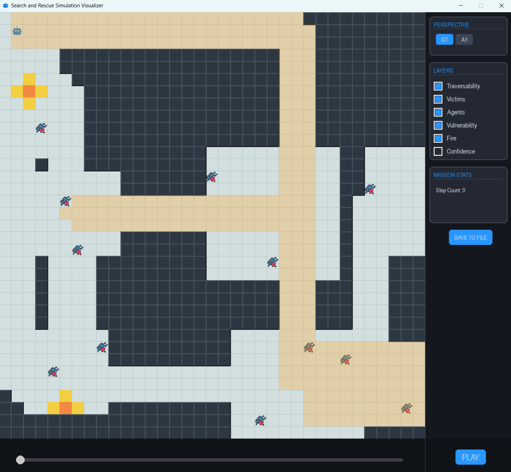

# RP 2026 - Autonomous Search and Rescue

## Description
This repository is a fork of a collaborative repository for group 20 of the TUDelft 2026 [CSE3000 Research Project](https://cse3000-research-project.github.io/2026/Q4). The project is titled: "Risk‑bounded, human‑aware autonomy: Safe reinforcement learning and predictive control in a post-disaster search and rescue testbed". All of team 20 contributed to the development of this project. This fork was aimed to develop a state-dependent dynamic tube model predictive control (SDD-TMPC) controller, which maps its perception of its local environment to a tube size. This controller was tested in a simulated search and rescue (SaR) environment, with walls/untraversable terrain, victims, and dynamic fires. Uniformly sampled noise is also included for further investigation into how the controller retains its behavior under increasing perceptual noise.

## Usage
The main method to perform a simulated search and rescue is the `Simulator` class. A simulation should be initialized with a simulation width and height, and the simulated world should be generated:
```py
sim = Simulator(35, 35)
sim.generate_ground_truth()
```
Optionally, simulation conditions can be customized with the `MapConfig` class, and the generation can be seeded, e.g:
```py
sim.generate_ground_truth(MapConfig(), seed)
```

An agent can then be created and inserted into the simulation:
```py
name = "mpc"
start_x, start_y = 1, 1
world_width, world_height = 35, 35
confidence_decay = 0.05
scan_accuracy, scan_radius = 0.35, 4
scan_falloff = True
agent: Agent = MpcAgent(
    name, 
    start_x, start_y, 
    world_width, world_height, 
    confidence_decay, 
    scan_accuracy, scan_radius, 
    scan_falloff
    )
sim.add_agent(agent)
```
The initializer for agents can be found under `src/agents/*.py`.\
The simulation can then be performed using the simulator's `run` method, which takes a maximum number of steps the simulation can run for. This method returns a datastructure that stores all intermediate states of the ground truth, and each agent's perception. More info can be found in the method doc at `src/simulator.py`.
```py
max_steps = 300
history = sim.run(max_steps)
```
The run can then be visualized using the `Visualizer` class:
```py
app_height_px, app_width_px = 1200, 1200
Visualizer(
    history, 
    app_height_px, app_width_px
    ).run()
```
Additionally, simulation metrics are stored in the `metrics` field of the `Simulator` class.

### Visualizer Features

#### Controls
The visualizer has a runtime bar at the bottom which can be scrolled through using the mouse or left/right arrow key.\
Play/pause can be operated through the on-screen button or the space bar.\
Properties which are visualized can be toggled on/off on the right-side menu, and a step count can be found just below. The perspective from which to visualize can be selected in the top right menu.\

#### Saved runs
A run can be saved to file by clicking the `SAVE TO FILE` button. The file path will be printed in the terminal. A saved run can be loaded into a visualizer instance using the `from_file` method in the `Visualizer` class:
```py
viz = Visualizer.from_file(
    file_path, 
    app_height_px, app_width_px
    )
```

## Data
All data and processing used for the research project can be found under the `saved_runs/data` directory. Data gathering code can be found in `src/main.py`.

## Running
Execution of the project is best done using the python `uv` package/project manager. To ensure the virtual environment has the correct packages loaded, the command
```shell
uv sync
``` 
should be run, after which the project can be executed with
```shell
uv run python -m src.main
```
